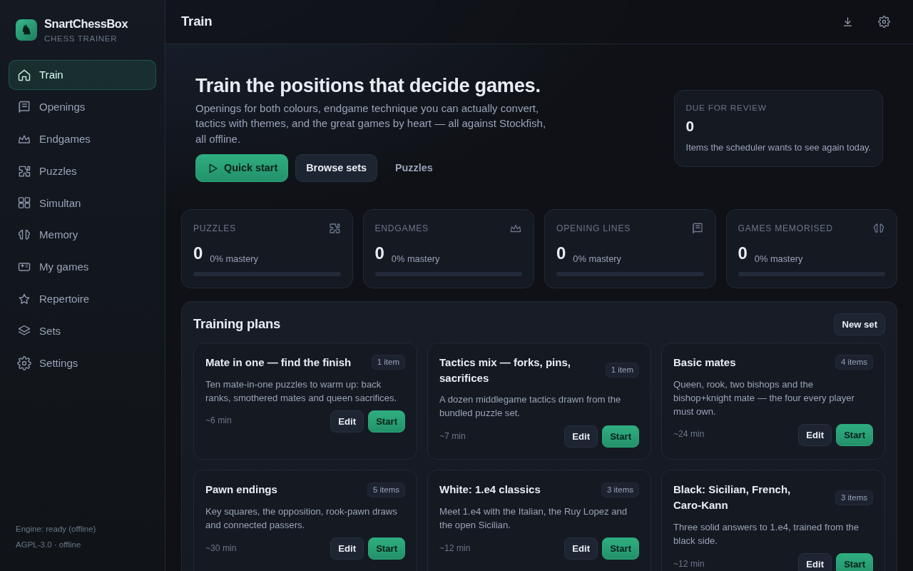

# SnartChessBox

An offline-first chess **training** app: opening repertoires for both colours, endgame
technique drills, themed tactics, simultaneous exhibitions against the engine, and
famous-game memorisation — all against a local Stockfish, all in the browser,
installable as an app on phone and desktop.

No accounts, no server, no telemetry. Everything lives in your browser's storage, and
the whole app (engine included) is cached by a service worker so it works on a plane.



---

## What it does

**Openings (white and black)**
- 3,300+ named lines from the Lichess opening database, searchable by name/ECO/length.
- Train either side: your moves are graded against the book, the opponent's moves autoplay.
- Hints draw the expected move as an arrow; a wrong move is rejected with the expected SAN.
- "Play on vs engine" when the line ends.

**Repertoire builder**
- Build a move tree by hand, import PGN (one game or a whole study), or **auto-build from
  your own games**: branches you actually reach, weighted by frequency, pruned by
  `min games` / `max depth`.
- **Exclude bad moves**: the engine evaluates every branch point and drops moves that lose
  more than N centipawns against the best move.
- **Browse mode**: every continuation of the current position is drawn as an arrow on the
  board — click an arrow or a move in the score sheet to walk the line. Alternatives are
  listed in parentheses beside each move.
- **Edit mode**: every move has its own edit button (jump, comment, replace, delete, "new
  variation from here"). Playing a different move on the board adds it *beside* the existing
  move, so it becomes a new variation instead of overwriting the line.
- Train the tree: the opponent picks weighted book replies, you must stay in your repertoire
  (with an "add this move" escape hatch when you deviate).

**Endgame drills**
- 17 positions with machine-checked results: queen/rook/two-bishop/bishop+knight mates,
  king+pawn technique, stalemate traps, rook-and-pawn bridge, back-rank patterns.
- Goal types (`mate`, `promote`, `hold the draw`), move budgets, take-backs, engine hints.
- Every drill is verified with Stockfish — see `tools/verify-endgames.mjs`.

**Tactics puzzles**
- 1,300+ puzzles from the Lichess puzzle database (CC0), every solution line replayed with
  chess.js at build time.
- Filter by theme (mate in 1/2/3/4, back rank, smothered mate, fork, pin, skewer,
  discovered attack, sacrifice, promotion, endgame, defence, …) and by rating band.

**Simultan (simultaneous exhibition)**
- Play 2–6 boards at once, one at a time, like walking the hall in a simul.
- Only the focused board is on screen; every other board whose move it is keeps
  *thinking debt* — it accumulates while you are away and is paid back as extra engine
  thinking time when that board answers, so looking away never weakens the opponent.
- Colour per board (White / Black / alternate), base thinking time, debt cap, board order.
- Score card (wins 1, draws ½), per-board status, resign, new exhibition.

**Game memory**
- 36 famous games (with sources) plus any game you add.
- Study mode steps through the game; quiz mode replays it and asks you to reproduce your
  side's moves from memory, with an accuracy score per run.

**Coaching on your own games**
- Import a PGN set, pick a game, and the engine reviews every position.
- Accuracy, blunders/mistakes/inaccuracies, a clickable move table, **red arrows on your
  bad moves** with the engine's move in green.
- "Play from here" starts a game against the engine from the critical position.

**Exercise sets (the training spine)**
- A set is an ordered list of exercises of any kind: opening lines, your repertoire,
  endgame drills, puzzle runs by theme, memory games, or a position from your own game.
- Built-in sets (Basic mates, Pawn endings, Mate in one, Tactics mix, opening starters,
  Opera Game memory) plus your own.
- Sessions run item by item with progress, skip/end, and a summary.

**Mobile**
- Pieces are filled SVG silhouettes (white = white fill with a dark rim) at 94 % of the
  square, so they stay legible at phone sizes; board size is capped by viewport height and
  the layout switches to two columns in landscape.

**Board tools (every board, every screen)**
- **Eval bar** with a live engine switch (off by default; the engine is hidden in puzzles and
  memory quizzes so it cannot hand you the answer).
- **Play engine from this position** — always present, on any board, including repertoire
  browsing, game review, drills and puzzles.
- **Move-list arrows** `|◀ ◀ ▶ ▶|` step back and forward through the line; reviewing an
  earlier ply is non-destructive and one click returns to the live position.
- **Variation arrows** on the board wherever a tree exists: the current move in green, the
  alternatives in blue, all clickable.
- Flip board, and the same strip on phone and desktop.

**Everything else**
- Engine think time (50 ms – 3 s per move) and playing strength (Skill/Elo, 400–max).
- **Randomness window**: play any move within ±X pawns of the engine's best move — the
  "top three moves within an eval spread" setting, with a live test button.
- Hints on/off, move sounds on/off (synthesised, no audio files), volume.
- Six board themes, three piece designs (DejaVu-derived SVG, so no font dependency).
- Export: PGN (games/repertoire/memory) or a **single-file bundle** with settings +
  repertoires + sets + games + progress. Import merges or replaces.
- Keyboard navigation in the review (← →), tap or drag on touch.

---

## Run it

Any static host works; the app is plain ES modules with no build step.

```bash
python3 -m http.server 8741     # then open http://localhost:8741
```

`file://` will not work — service workers and ES modules need an origin.

**Install:** open the site in Chrome/Edge/Safari → *Install app* / *Add to Home Screen*.
After the first load everything (Stockfish WASM, puzzles, openings) is cached and the app
runs with no network.

---

## Engine settings, precisely

| Setting | Meaning |
| --- | --- |
| Think time | `go movetime` budget per engine move. Drills and review use their own minimums. |
| Strength | `UCI_LimitStrength` + `UCI_Elo` from 1320 up; below that `Skill Level` and a shorter think time (Stockfish's Elo floor is 1320). |
| Randomness window | The engine searches MultiPV (top 3–5 moves) and then plays a move chosen from those whose score is within `spread` of the best. With best `+1.30` and `±1.00`, anything down to `+0.30` is allowed; `-3.20` never is. Mate scores live in their own band, so a forced mate is never traded for material. |
| Weighting | `uniform` (equal chance), `softmax` (favours the better moves), `best` (ignore the window). |

The spread logic is `js/core/evalband.js` and is covered by unit tests
(`tests/core.test.mjs`).

---

## Project layout

```
index.html            app shell (sidebar/topbar/bottom nav)
css/style.css         design system, board themes, responsive layout
js/app.js             boot, state, IndexedDB persistence, hash router, seeding
js/core/              pure logic, no DOM — unit-tested in Node
  chessutil.js          chess.js wrappers, material/endgame classification, eval helpers
  evalband.js           "top N within ±spread" move selection
  pgn.js                tolerant PGN parser + writer (comments, variations, multi-game)
  repertoire.js         move tree: build/count/prune/annotate/drop bad moves
  moveclass.js          cp-loss → best/good/inaccuracy/mistake/blunder, red arrows
  memory.js             memorisation plans and answer checking
  srs.js                spaced-repetition ladder
  sets.js               exercise sets and puzzle-run expansion
  endgames.js           drill library + goal judgement
  backup.js             single-file bundle + PGN export, merge strategies
js/ui/                board renderer, pieces, engine worker client, sound, store, helpers
js/trainers/          one trainer per activity (opening, endgame, puzzle, memory, freeplay)
js/views/             one screen per route (home, openings, endgames, puzzles,
                      simultan, memory, coach, repertoire, sets, session, settings)
vendor/chess.mjs      chess.js (ESM)
engines/              Stockfish 19 lite, single-threaded WASM build
data/                  generated datasets (openings, puzzles, famous games)
tools/                dataset builders + endgame verifier + browser checks
tests/                node:test suites (core logic, datasets, PWA integrity)
```

**Storage:** one IndexedDB key/value store (`snart-chessbox`), keys `settings`,
`repertoires`, `sets`, `games`, `memoryGames`, `progress`, `analyses`, `customPuzzles`.
Settings are mirrored to `localStorage` for fast boot.

**Progress model:** every finished item records an SRS entry
(`puzzle:<id>`, `endgame:<id>`, `opening:<id>:<side>`, `memory:<id>`, `repertoire:<id>`)
with a 0/1/3/7/16/35/70/120-day ladder. "Clean" runs (no hints, no wrong moves) advance;
failures step back.

---

## Development

```bash
npm test                 # node --test tests/   (core logic + datasets + PWA integrity)
npm run test:browser     # Playwright: boot, screens, engine, puzzle, offline, installability
npm run test:flows       # Playwright: line training, PGN import + review, memory, sets, export
npm run verify:endgames  # Stockfish confirms every drill's stated result
```

The browser checks need `playwright` (`npm i -D playwright` + `npx playwright install chromium`).

Regenerate bundled data:

```bash
npm run build:openings   # data/openings.json   from lichess-org/chess-openings (CC0)
node tools/build-puzzles.mjs   # data/puzzles.json  from database.lichess.org (CC0, ~300 MB download)
node tools/build-famous-games.mjs  # data/famous-games.json (source-verified PGNs)
npm run pieces           # js/ui/piece-paths.js  (DejaVu glyph outlines → paths)
npm run icons            # icons/*.png           (from the committed SVGs)
```

**Bumping the service worker:** change `VERSION` in `sw.js` whenever a cached asset
changes — `activate` is what replaces the old build on installed devices. `tests/pwa.test.mjs`
fails if the precache list, the page's asset list and the disk disagree.

---

## Licences

- App: **AGPL-3.0-or-later** (see `LICENSE`).
- Engine: [Stockfish.js 19](https://github.com/nmrugg/stockfish.js) — GPL-3.0. The bundled
  file is the *single-threaded lite* build (the multi-threaded build needs
  cross-origin-isolation headers a static host cannot set).
- Rules: [chess.js](https://github.com/jhlywa/chess.js) — BSD-2-Clause (`vendor/chess.mjs`).
- Openings: [lichess-org/chess-openings](https://github.com/lichess-org/chess-openings) — CC0-1.0.
- Puzzles: [Lichess puzzle database](https://database.lichess.org/#puzzles) — CC0-1.0.
- Piece outlines: DejaVu Sans (Bitstream Vera / DejaVu licence), converted to paths by
  `tools/make-pieces.py`.

The engine is loaded as a separate GPL-3.0 work; the app communicates with it over the UCI
message protocol, which the AGPL does not relicense.

---

## Known limits

- Analysis quality is deliberately small-engine/short-time; it is a training tool, not an
  analysis desktop.
- Repertoire auto-build uses your imported games' frequency, not a database of opponent
  tendencies.
- Puzzle ratings come from Lichess; a puzzle's "solution" is the engine-checked main line.
- The review's engine pass is cached per game in IndexedDB; clearing the game library
  drops the analyses too.
